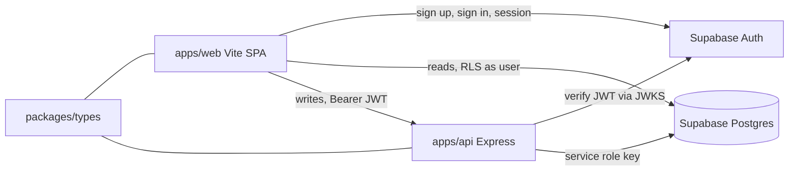

# Auth, pages and api backend

## Frontend: move to Vite

Recommendation: replace Next.js with Vite (React + react-router + TanStack Query).

- Next.js is not redundant just because a backend exists, but its main benefits are SSR, SEO and link previews. You said pages are mostly private, so none of those apply. Next would leave us with two servers and two places for server logic: Next server components and the Express api.
- A Vite SPA is a static bundle. It is simple to host, and it matches the ooh/platform setup, so patterns and rules carry over.
- Cost of switching now: `apps/web` is only the create-next-app scaffold (a `page.tsx`, a `layout.tsx` and two supabase helpers), so nothing is lost.
- If public indexable pages are wanted later, a small SSR or prerender layer can be added just for those routes.

## Architecture (copied from ooh/platform)



- Auth: the frontend uses `supabase-js` directly for `signUp`, `signInWithPassword`, `signOut` and session. The api never sees passwords.
- Api auth: the api verifies the Supabase access token with `jose` against `${SUPABASE_URL}/auth/v1/.well-known/jwks.json` (audience `authenticated`), then sets `req.uid` from `sub`. Same as `ooh/platform/apps/api/src/auth.ts` and `middleware/authenticate.ts`.
- Reads: the frontend reads directly from Supabase, and RLS enforces ownership.
- Writes: the frontend writes through api endpoints. The api uses the service role key, so it must always set `owner_id` from the verified `uid`, never from the request body.

## 1. Data model and Supabase

New migration `supabase/migrations/<timestamp>_pages.sql`:

- Table `public.pages`:
  - `id uuid primary key default gen_random_uuid()`
  - `owner_id uuid not null references auth.users(id) on delete cascade`
  - `name text not null check (char_length(btrim(name)) between 1 and 100)`
  - `created_at timestamptz not null default now()`
  - `updated_at timestamptz not null default now()`, with a `set_updated_at` trigger
  - index on `(owner_id, created_at desc)`
- RLS enabled on `pages`:
  - Policy `select` for `authenticated` using `owner_id = (select auth.uid())`.
  - No insert, update or delete policies. Writes only go through the api, which uses the service role.
- No `profiles` table for now, since nothing needs it. `auth.users` is enough.

Config changes:

- `supabase/config.toml`: set `site_url` to the Vite dev URL (`http://127.0.0.1:5173`) and fix `additional_redirect_urls`. Keep email confirmations off locally so signup works immediately.
- Run `supabase start` and `supabase db reset` to apply the migration.
- Root script `db:types`: `supabase gen types typescript --local --schema public > packages/types/src/database.gen.ts`.

## 2. Shared types: `packages/types` (`@ww/types`)

- `package.json` with `exports: { ".": "./src/index.ts" }`, so no build step. Depends on `zod`.
- `src/database.gen.ts` is generated and is the source of truth for table shapes.
- `src/index.ts` exports `Database` and helpers `Tables`, `TablesInsert` and `TablesUpdate`, plus the api contract.
- `src/api/pages.ts`:
  - `createPageBodySchema = z.object({ name: z.string().trim().min(1).max(100) })`
  - `type Page = Tables<'pages'>`
- Both `apps/api` and `apps/web` depend on `@ww/types` via `workspace:*`.
- Add a root `tsconfig.base.json` that the packages extend.

## 3. Backend: `apps/api`

Express 4 + TypeScript + `tsx watch`, ESM, `zod`, `jose`, `@supabase/supabase-js`, `dotenv`. This is a trimmed version of ooh/platform.

```
apps/api/src/
  index.ts              listen on API_PORT (default 8001)
  app.ts                express.json, authenticate, routers, 404, errorHandler
  env.ts                dotenv from apps/api/.env.local, requireEnv
  db.ts                 service-role client typed with Database
  auth.ts               parseBearerToken, verifySupabaseToken (JWKS)
  http.ts               HttpError
  middleware/authenticate.ts, requireAuth.ts, errorHandler.ts
  routes/health.ts      GET /healthz (public)
  routes/pages.ts       POST /pages
  services/pages.ts     createPage(uid, body)
```

Endpoints (mounted under `/api`):

- `GET /healthz`: public.
- `POST /pages`: authenticated. Parses the body with `createPageBodySchema` and inserts `{ owner_id: uid, name }`. It returns `201` with the created `Page`.
- Listing and viewing pages are reads, so the frontend queries Supabase directly. No `GET /pages` endpoint for now.

Env in `apps/api/.env.local` (with an `.env.local.example`): `SUPABASE_URL`, `SUPABASE_SECRET_KEY` (service role), `API_PORT`.

## 4. Frontend: replace `apps/web` with Vite

- Remove the Next.js files (`next.config.ts`, `src/app`, `next-env.d.ts`, the eslint-config-next dependency and the Next-specific supabase helpers).
- New `apps/web`: Vite + React 19 + TypeScript + Tailwind v4 (`@tailwindcss/vite`) + `react-router-dom` + `@tanstack/react-query` + `@supabase/supabase-js` + `@phosphor-icons/react` + `@ww/types`.
- `vite.config.ts` proxies `/api` to `http://localhost:8001`.
- Env: `VITE_SUPABASE_URL` and `VITE_SUPABASE_ANON_KEY`. Reuse the current local values from `.env.example`, renamed.
- Structure:
  - `src/lib/supabase.ts`: typed client `createClient<Database>`.
  - `src/api/client.ts`: `apiFetch(path, accessToken, init)` with the Bearer header.
  - `src/api/pages.ts`: `createPage` and a `useCreatePage` mutation that invalidates the pages query.
  - `src/lib/auth/AuthProvider.tsx`: session state via `onAuthStateChange`, plus a `RequireAuth` route guard.
  - `src/views/AuthView.tsx`: one view for sign in and sign up, with a toggle and email and password fields.
  - `src/views/PagesView.tsx` (route `/`): lists the user's pages via `supabase.from('pages').select()` ordered by `created_at desc`. It has a simple create form (name input, button) that calls the api.
  - `src/views/PageView.tsx` (route `/pages/:id`): `.select().eq('id', id).maybeSingle()`, showing the name in a serif heading, plus a back link. It shows "not found" when RLS returns nothing.
- Styling follows AGENTS.md: minimal, no borders or section dividers, spacing and weight for structure, serif headings and sans body, Phosphor icons only, and no dot or bar characters in the UI.

## 5. Monorepo plumbing

- `pnpm-workspace.yaml` stays at `apps/*` and `packages/*`.
- Root `package.json` scripts: `web` (frontend dev), `api` (api dev), `db:types`, `typecheck`, and the existing `supabase:*` and `db:reset` scripts. `dev` should start web and api together, for example with `pnpm -r --parallel --filter web --filter api dev`.
- Update the `build`, `start` and `lint` scripts that point at the Next app.
- Add `apps/web/AGENTS.md` cleanup. The current one is Next-specific and should be removed or rewritten.
- Optional: add `.cursor/rules` for the read/write split (reads direct from Supabase, writes via the api).

## Order of work

Do the data model and Supabase first, then types, then the api, then the frontend. Check each step before moving on:

1. Run `db:reset`.
2. Generate the types.
3. `curl` `POST /pages` with a real JWT.
4. Test in the browser: sign up, create a page, view it, and confirm another user can't see it.